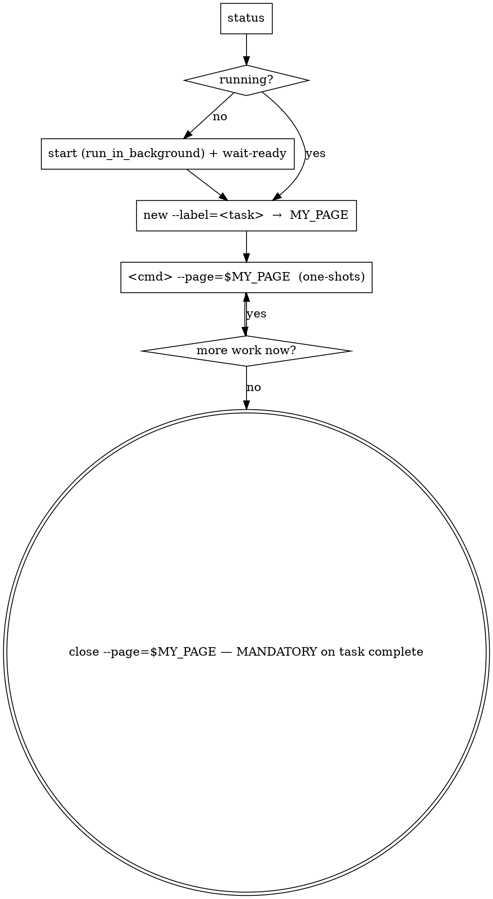

# NativeWright

One principle: **route every browser automation action through the shared NativeWright daemon. Never use ad-hoc browser automation.**

NativeWright wraps Patchright — a Playwright fork — in a long-lived HTTP daemon, so AI coding agents (Claude Code, Cursor, Codex, Gemini CLI) can drive a single real Chrome with a persistent profile across many one-shot shell calls. Any number of agents can share one daemon safely: **every agent gets its own page, in its own window, addressed by a stable id.**

## When to use this skill

Use this skill when the task involves:
- Opening any site that renders content via JavaScript (SPAs, React/Vue/Svelte apps).
- Interacting with a real UI: clicking, typing, selecting, submitting forms, uploading files.
- Visiting a site that requires login or session cookies.
- Capturing screenshots, HTML, or DOM for evidence.
- Stepping through a multi-step flow (checkout, wizard, generator).
- Monitoring browser-side network traffic.

## When NOT to use

Prefer lighter tools instead when:
- The site returns the needed data in static HTML or a JSON API (use `WebFetch` or plain `curl`).
- You only need a fact lookup (use `WebSearch`).
- You are inspecting HTML files on disk (use `Read`).
- You need to compare pure text content and the page has no JS (use `WebFetch`).

Rule of thumb: launching a browser is expensive. Skip it when a plain HTTP request suffices.

## Locating the binary

If installed globally via `npm install -g nativewright`, the bin `nativewright` is on PATH — call it directly. If nothing is installed yet:

```bash
npm install -g nativewright
npx patchright install chrome        # or: chromium
```

Always reference the binary as `nativewright`. Never hardcode script paths.

## The model: one page per agent, addressed by a stable id

The daemon has **no shared "active page"**. Every page-targeting command names its page with `--page=<id>`, and the daemon binds the command to that page inside that page's own queue. Two agents can never clobber each other because nothing they touch is shared mutable state.

- `new` opens a page **in its own window** and returns a stable id (`p1`, `p2`, …). The id never changes and is never reused, even when other pages close.
- Pass `--page=<id>` on **every** page command. If exactly one page is open you may omit it; if more than one is open and you omit it, the daemon **refuses** with a clear error (it never guesses — a guess is how one agent would end up driving another's page).
- Frame scope, dialog policy, console/network buffers are all per page.
- Commands on different pages run **concurrently**; commands on the same page are serialized.
- Artifacts (`shot`, `save-artifact`, downloads) are written under **your** working directory (`./artifacts/`), not the daemon's — agents in different projects don't mix files.
- A page in its own window stays a foreground page (`visibilityState: 'visible'`, timers and rAF running) even when other windows overlap it. Background *tabs* in a shared window are hidden and throttled, which breaks animations, observers, lazy-loading and screenshots — that is why each page gets a window.

## Lifecycle in an agent session



### 1. Check / start

```bash
nativewright status
```

If `running: true`, reuse it (other agents may already have pages — that's fine). If not:

```
Bash(command='nativewright start', run_in_background=true)
```

```bash
nativewright wait-ready --timeout=30000
```

### 2. Claim your page

```bash
nativewright new --label=<short-task-name>
# → {"ok":true,"result":{"page":"p3","url":"about:blank","windowId":…,"hint":"pass --page=p3 …"}}
```

Remember the returned `page` id (call it `MY_PAGE`) for the rest of your task. The label shows up in `pages` so a human can tell whose window is whose.

### 3. Drive your page

Every command is one-shot. Exit code 0 = `ok:true`, exit code 1 = `ok:false`. Output is always JSON and echoes the `page` it acted on.

```bash
nativewright goto https://example.com --page=$MY_PAGE
nativewright text h1 --page=$MY_PAGE
nativewright click "button.submit" --page=$MY_PAGE
nativewright fill "input[name=q]" "my query" --page=$MY_PAGE
nativewright shot baseline --page=$MY_PAGE
```

In a persistent shell you may pin the page once instead of repeating the flag: `export NATIVEWRIGHT_PAGE=p3` (an explicit `--page` always wins). From Claude Code each Bash call is a fresh shell, so just pass `--page`.

### 4. Release your page — MANDATORY when the task is complete

<HARD-GATE>
When your browser task is done, you MUST close your page before your final message to the user:

```bash
nativewright close --page=$MY_PAGE
```

Do NOT call `stop` as part of normal work. Pages are leases: closing yours releases it; other agents' pages keep running. When no pages have been open for `NATIVEWRIGHT_IDLE_EXIT_MS` (default 10 min; `0` = never) the daemon exits gracefully on its own, flushing cookies and session state to the profile. Leaving your page open after the task is over holds the daemon up and leaks a window.
</HARD-GATE>

**`stop` is an admin operation.** It refuses while any page is open (`stop refused: N page(s) still open …`). Use `stop --force` only when you deliberately want to shut everything down regardless of other agents (e.g. the human asked, or you are recovering a wedged browser).

**Decision rule**: if you are about to say "готово" / "done" / present the final artifact, the line above it should be `close --page=$MY_PAGE`.

### Human-behavior layer (on by default)

Every interaction command (`click`, `dblclick`, `rightclick`, `fill`, `type`, `press`, `hover`, `scroll`, and the post-load idle of `goto`) routes through a realistic input synthesizer: curved mouse paths with per-frame coalesced pointer samples, Fitts-like timing, keystrokes with real Shift handling and per-key dwell, real `page.mouse.wheel` ticks. This is the default and what you want almost always.

**When to use `--raw=true`** (opt out):
- The element is invisible / offscreen and you just need the event dispatched.
- Deterministic test suites where timing variance is noise.
- Internal tools / test environments where fidelity doesn't matter.

**`--seed=<int>`** makes the randomness reproducible for debugging a flaky selector. Never reuse a fixed seed across real sessions — identical trajectories across runs are a fingerprint.

**Behaviour to be aware of**:
- `goto` adds a 300–2000 ms "reading" pause after load.
- `fill` selects and clears the field (gesture varies), then types at human cadence — works on React-controlled inputs and contenteditables that reject programmatic fill.
- `type` clicks the field first (focus via real mouse event), then types.
- Typo simulation (~0.8% per char) is **auto-disabled for password/OTP/CVV/PIN/secret/token fields**.
- Scroll uses real wheel events and stops when the page can't scroll further.

## Command reference

All page commands accept `--page=<id>` (required when >1 page is open), `--timeout=<ms>` (default 30000) and `--key=value` flags for any non-positional option. Interaction commands additionally accept `--raw=true` and `--seed=<int>`.

| Group | Command | Positional | Notes |
|---|---|---|---|
| Pages | `new [--label=name] [--window=false]` | — | opens a page in a NEW window; returns its stable id |
|  | `pages` | — | lists open pages: id, label, url, windowId, opener, cwd |
|  | `close --page=<id>` | — | closes that page (lease released) |
| Nav | `goto <url>` | url | `--waitUntil=load\|domcontentloaded\|networkidle`; human post-load idle |
|  | `back` / `forward` / `reload` | — |  |
| Interact | `click <selector>` | selector | `--raw=true`, `--button=left\|right\|middle`, `--clickCount=1\|2\|3` |
|  | `dblclick <selector>` | selector | double-click |
|  | `rightclick <selector>` | selector | right-button click |
|  | `fill <selector> <value>` | selector, value | select-all + clear + typed at human cadence |
|  | `type <selector> <text>` | selector, text | human keystroke cadence; `--typos=on\|off\|auto` |
|  | `press <key>` | key | e.g. `Enter`, `Control+A`, `ArrowDown` |
|  | `hover <selector>` | selector | human mouse path to element |
|  | `select <selector> <value>` | selector, value | `<select>` option |
|  | `scroll <top\|bottom\|up\|down\|<px>>` | direction | real wheel ticks with edge-detection |
|  | `upload <selector> <path>` | selector, path | file input; absolute or relative to YOUR cwd |
| Wait | `wait <ms>` | ms | blind sleep (prefer wait-for) |
|  | `wait-for <selector>` | selector | `--state=visible\|hidden\|attached\|detached` |
|  | `wait-for-load` | — | `--state=load\|domcontentloaded\|networkidle` |
| Read | `text [selector]` | selector? | inner text of element or body |
|  | `html [selector]` | selector? | outerHTML or full document |
|  | `title` / `url` | — |  |
|  | `get <selector> <attr>` | selector, attr | getAttribute |
|  | `count <selector>` | selector | number of matches |
|  | `eval <js>` | js | expression or statements; returns `{value}` |
|  | `cookies [--url=...]` | — | domain-scoped cookie dump (pageless) |
| Frames | `frame <name>` | name | subsequent commands on THIS page target this frame |
|  | `frame --reset` | — | clear frame scope for this page |
| Dialogs | `dialog <accept\|dismiss> [prompt]` | action, promptText? | policy for this page's alert/confirm/prompt |
| Artifacts | `shot [name]` | name? | PNG under `./artifacts/` of your cwd |
|  | `save-artifact [name]` | name? | PNG + HTML + metadata JSON bundle |
|  | `downloads [--n=N]` | — | this page's captured downloads |
| Diagnostics | `network-log [--n=N]` | — | this page's recent requests/responses |
|  | `state` | — | daemon snapshot: pages, idle timer, recent commands (pageless) |
| Viewport | `viewport <w> <h> --force` | w, h | overrides the real window geometry; requires `--force` |

`switch` and page indices no longer exist — ids are stable and every command names its page.

## Persistent profile

The profile lives under the platform-default data root (override via `NATIVEWRIGHT_USER_DATA_DIR`):

| OS | Default path |
|---|---|
| Windows | `%LOCALAPPDATA%\NativeWright\profile\default\` |
| macOS | `~/Library/Application Support/NativeWright/profile/default/` |
| Linux/BSD | `${XDG_DATA_HOME:-~/.local/share}/nativewright/profile/default/` |

Cookies, localStorage, and IndexedDB survive daemon restarts. Sessions on mature sites (Google, Microsoft) typically last ~2 weeks before device-token re-auth.

**Never open a normal Chrome window pointed at the same profile directory.** Chrome holds a profile lock; a second opener will fail or corrupt state. If `start` fails with a profile-lock error, a real Chrome (or a zombie daemon Chrome) is using the directory — close it, check `tasklist | findstr chrome` (Windows) or `pgrep -fl chrome` (Unix), then retry.

**One daemon per profile.** All agents working under the same logged-in identity share one daemon (each with their own page). A different identity / network setup is a different **named profile**: put `--profile=<name>` on every command (`start`, `status`, `new`, `goto`, …) and it runs as its own daemon with its own Chrome profile, cookies, extensions and lockfile under `<data root>/profiles/<name>/`. Without the flag you are on the default (logged-in) profile.

| Profile | What it is | Use for |
|---|---|---|
| default (no flag) | the human's logged-in accounts, one stable IP | everything normal |
| `vpn` | no accounts; Browsec VPN installed (Proton / Windscribe installed but not logged in) | anything blocked **by IP** — see the `nativewright-vpn` skill |

Requires nativewright ≥ 2.1.0: `nativewright status --profile=vpn` must print `"profile": "vpn"`. Older versions ignore the flag and would run in the default profile — stop and report if the field is missing.

## Blocked by IP? → `nativewright-vpn`

If a page says *"Daily limit reached … from your IP"*, *"too many requests"*, returns HTTP 429 for a per-IP quota, or the task needs another country: **do not** try anything in the default profile. Switch to the `nativewright-vpn` skill — it moves the task into the `vpn` profile, turns the VPN on, verifies the new IP and retries there. CAPTCHA / "unusual traffic" pages are NOT this case — hand those to the human.

## First-run login

If the target site requires login and your profile has none yet, delegate to the `nativewright-login-bootstrap` skill — it codifies the manual-login dance exactly once per site.

## Debugging

- `nativewright status` lists open pages (id, label, url); `--verbose` adds the last 20 commands with timings and the idle-timer state.
- `nativewright network-log --page=$MY_PAGE` shows this page's recent requests.
- The daemon log is at `$NATIVEWRIGHT_HOME/logs/daemon.log`; every line is tagged with the page it acted on (`[p3] fill ok 6272ms`).
- If a one-shot returns `ok:false`, the daemon and your page stay alive — diagnose immediately without restarting.
- Stale lockfile (`daemon.json` exists but `status` says `running:false`)? `nativewright start` reaps it automatically.

## Common pitfalls

| Symptom | Cause | Fix |
|---|---|---|
| `N pages are open (...); pass --page=<id>` | you omitted `--page` while other agents have pages | pass `--page=$MY_PAGE` (always do, it's harmless when alone) |
| `no page 'p3'` | that page was closed, or a typo | `nativewright pages`; if yours is gone, `new` again |
| `no pages open — run new first` | nobody has claimed a page yet | `nativewright new --label=…` |
| `daemon not running` | never started, or idle-exited after the last page closed | `start` in background, then `wait-ready`, then `new` |
| `stop refused: N page(s) still open` | other agents are mid-task | just `close --page=$MY_PAGE`; only `stop --force` if you truly mean to kill everything |
| Selector timeout | element hasn't rendered | prefer `wait-for <selector>` over blind `wait <ms>` |
| `profile lock` error on start | a Chrome already uses the profile | close that Chrome; check processes |
| `viewport` rejected | guardrail | pass `--force=true` and understand you're overriding real geometry |

## Routing other skills through this one

When other skills need a browser, they **must** defer here: claim a page with `new`, pass `--page=$MY_PAGE` on every command, `close` it when done. Never invent parallel browser logic. Never reach for Playwright directly. Never launch Chrome manually.
